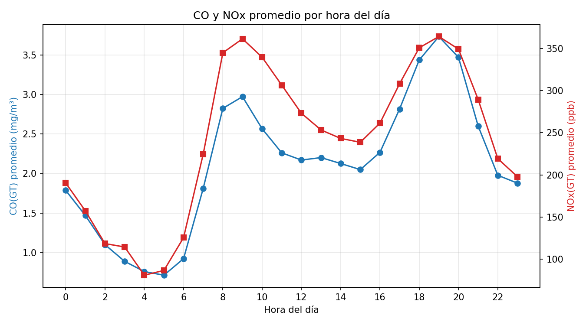
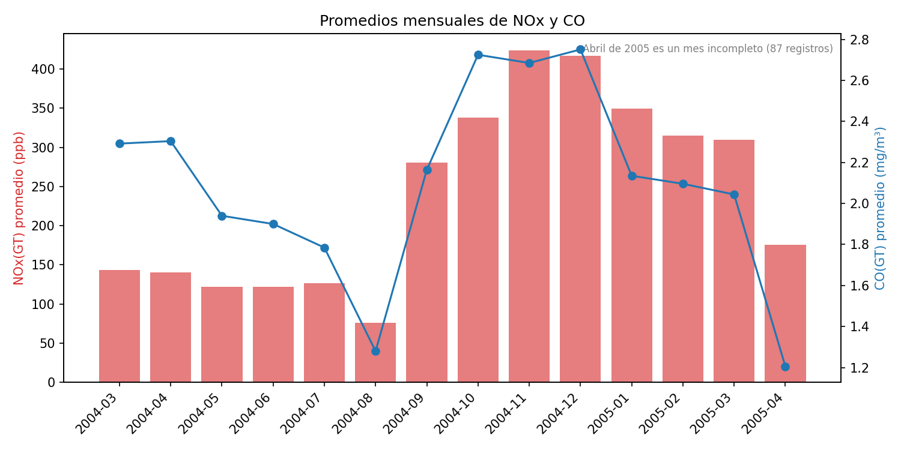
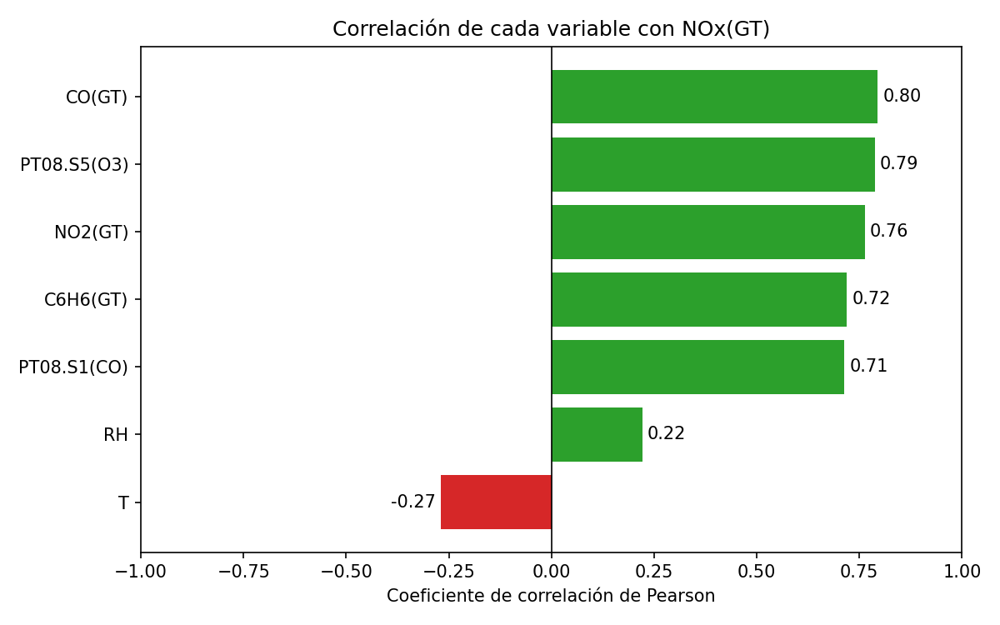
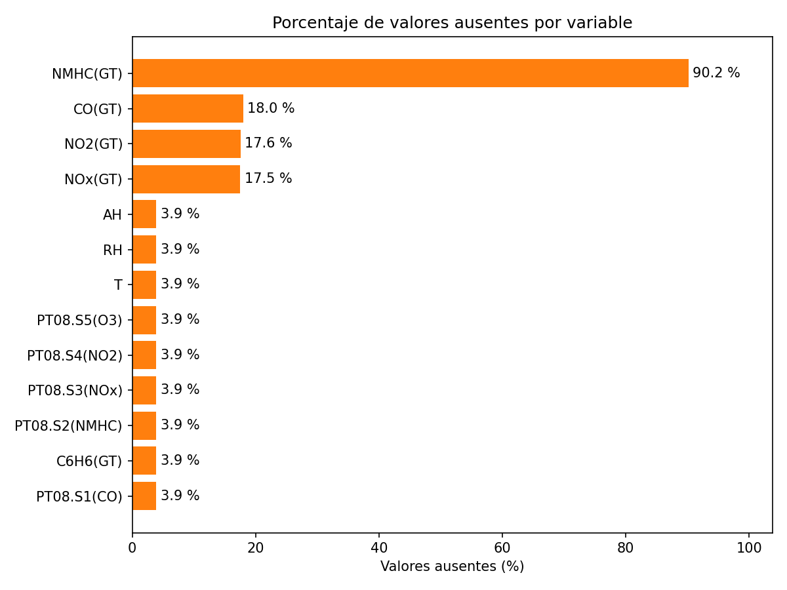

# Análisis de calidad del aire con PySpark

Procesamiento batch y en tiempo real del dataset Air Quality (UCI Machine
Learning Repository) con Apache Spark 3.5.8, Apache Kafka 3.9.2 y Python.

## Qué hace
- Carga y limpia AirQualityUCI.csv (coma decimal, -200 como dato ausente, fecha y hora).
- Resumen estadístico, promedios generales, mensuales y por hora.
- Correlaciones con NOx(GT) y porcentaje de valores ausentes.
- Exporta 7 archivos CSV a la carpeta resultados/.
- Simula datos en tiempo real con Kafka y los procesa con Spark Streaming.

## Requisitos
Java 11, Apache Spark 3.5.8 y Python 3.
Para el tiempo real: Apache Kafka 3.9.2 (en /opt/Kafka) y la librería
kafka-python (pip install kafka-python).

## Ejecución (procesamiento batch)
    cd data
    python3 -m py_compile analisis_calidad_aire.py
    spark-submit analisis_calidad_aire.py

## Gráficas

Después del análisis, y desde la misma carpeta data, genera las gráficas
(requiere matplotlib):

    pip install matplotlib
    python3 graficas_calidad_aire.py

Las imágenes se guardan en resultados/graficas/:

## Tiempo real: Kafka y Spark Streaming

El productor reenvía al topic calidad_aire una medición por segundo tomada de
resultados/datos_limpios.csv (se genera con el análisis batch). El consumidor
calcula, por ventanas de 1 minuto, el número de mediciones y los promedios de
CO, NO2, NOx y temperatura.

1. Iniciar ZooKeeper y Kafka:

        nohup /opt/Kafka/bin/zookeeper-server-start.sh /opt/Kafka/config/zookeeper.properties > ~/zookeeper.log 2>&1 &
        nohup /opt/Kafka/bin/kafka-server-start.sh /opt/Kafka/config/server.properties > ~/kafka.log 2>&1 &

2. Crear el topic (solo la primera vez):

        /opt/Kafka/bin/kafka-topics.sh --create --bootstrap-server localhost:9092 --replication-factor 1 --partitions 1 --topic calidad_aire

3. En una terminal, ejecutar el productor (detener con Ctrl+C):

        cd data
        python3 kafka_producer.py

4. En otra terminal, ejecutar el consumidor:

        cd data
        spark-submit --packages org.apache.spark:spark-sql-kafka-0-10_2.12:3.5.8 spark_streaming_consumer.py

Cada 10 segundos se muestra en consola una tabla con las estadísticas por
ventana. La interfaz web de Spark queda disponible en http://IP_DE_LA_VM:4040.

## Dataset
https://archive.ics.uci.edu/dataset/360/air+quality
